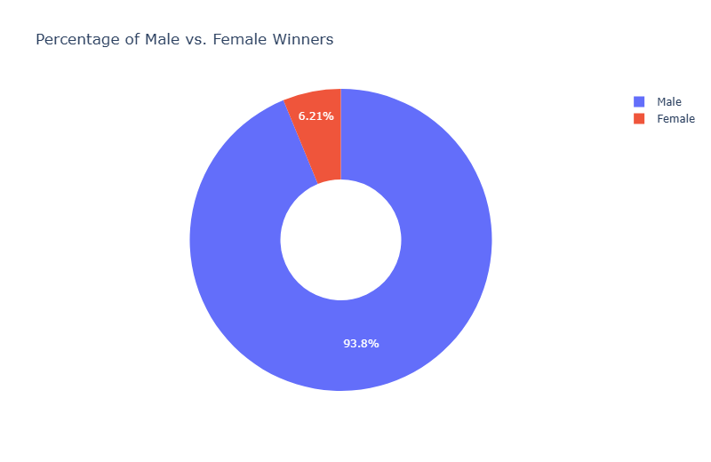
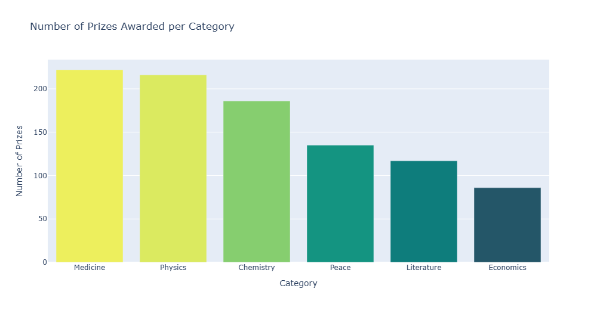
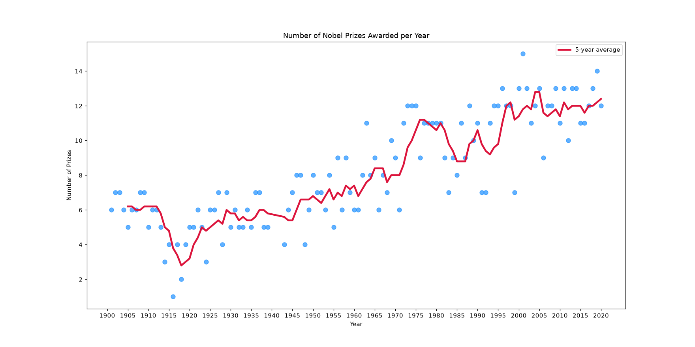
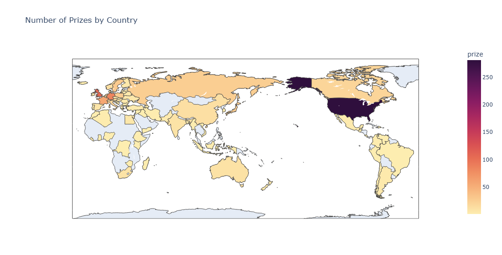
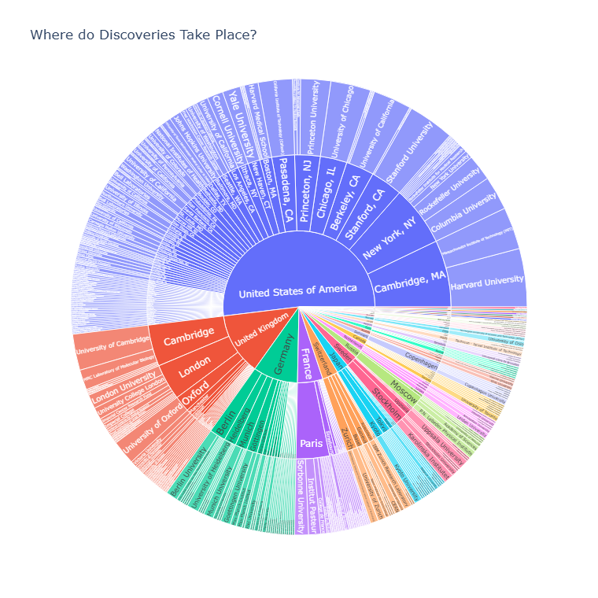
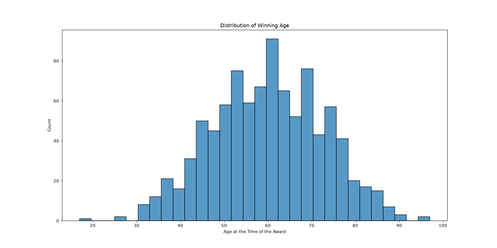

# 🚀 079 Nobel Prize Analysis

Day 79 of Udemy's *100 Days of Code: The Complete Python Pro Bootcamp*: analyse 120 years of Nobel Prize data with Pandas, Plotly, Matplotlib and Seaborn. It is for course participants who want runnable, tested code and for anyone browsing for ideas.

## 📚 Table of Contents

- [Overview](#-overview)
- [Requirements](#-requirements)
- [Setup](#-setup)
- [Run](#-run)
- [Tests](#-tests)
- [License](#-license)
- [Links](#-links)
- [Appendix: Project documents](#-appendix-project-documents)

## 🧭 Overview

The project answers the questions of the Day 79 assignment: how the data looks and what is missing, which categories award the most prizes, how many laureates are women, how the number of prizes changed over time, which countries, organisations and cities win the most, and how old laureates are when they win.

| Folder | What it holds |
| --- | --- |
| `src/nobel_analysis/` | The analysis functions, named as in the assignment, and `constants.py` |
| `tests/` | Tests that assert the values from the lecture |
| `notebooks/` | The Jupyter notebook that follows the lecture step by step |
| `data/` | `nobel_prize_data.csv` from the lecture (962 prizes, 1901 to 2020) |
| `docs/` | Project documents, chart images (`docs/images/`) and the wiki sources (`docs/wiki/`: English, Danish, Bahasa Malaysia) |
| `scripts/` | `scan.sh` (opengrep), `make_wiki.py` (wiki pages), `make_notebook.py` (notebook), `make_screenshots.py` (chart images) |

### 🖼️ Lecture steps

A short summary of each lecture step (Udemy lectures 583 to 590, in our own words) and the charts the code draws for that step (regenerate them with `python scripts/make_screenshots.py`). The [wiki][wiki] (English, Dansk, Bahasa Malaysia) explains what each step teaches.

**Step 1: The goals of the day**

The lecture introduces the day: study the history of the Nobel Prize to see who wins, where and when. It lists the charts we will build (a choropleth map, bar and sunburst charts, regression lines and a histogram) and the questions we will ask of the data.

**Step 2: Explore and clean the data set**

The lecture loads the data set and inspects it: its shape, the first and last rows, duplicates and missing values. It then converts the birth date to a real date and turns the prize share into a percentage so later steps can calculate with it.

**Step 3: Bar and donut charts with plotly**

The lecture asks how many prizes go to women and which categories award the most. It answers with a donut chart for the share of women, a ranking of the first female laureates and repeat winners, and a stacked bar chart of prizes per category and sex.





**Step 4: Trends over time with Matplotlib**

The lecture looks at the number of prizes per year and asks whether more prizes are given now. A 5 year rolling average smooths the noise, and a second axis shows whether prizes are shared among more people over time.



**Step 5: A choropleth map and the top countries**

The lecture ranks the countries by prizes won, discusses which country column is the least problematic, and draws the result as a bar chart and a choropleth map. It ends with the prizes of each country split by category and a running total over time.



**Step 6: Sunburst charts of research locations**

The lecture asks where discoveries are made. It ranks research organisations and cities, compares them with where laureates were born, and shows the country, city and organisation hierarchy in a sunburst chart.



**Step 7: The age of the laureates**

The lecture calculates the age at which each laureate won, finds the oldest and youngest, and shows the distribution in a histogram. Regression lines and box plots then show how the age differs by category and has changed over the years.



**Step 8: Learning points and summary**

The lecture closes the day by reviewing what was practised (missing values, type conversion, donut and bar charts, rolling averages, grouping and sorting) and listing what was new (choropleth maps, sunburst charts, regression lines and histograms).

## 📋 Requirements

- Python 3.13 or newer, to run the code.
- `pandas`, `numpy`, `plotly`, `matplotlib` and `seaborn`, the runtime dependencies the charts need; they are installed by the setup below.
- `pytest`, `ruff`, `mypy` and Jupyter, only for development; installed with the `dev` extra.
- Optional: [Doxygen][doxygen] to build the API documentation from the source comments.

## 🛠️ Setup

Create and use a local virtual environment named `.venv`.

Windows (PowerShell):

```powershell
python -m venv .venv
.venv\Scripts\Activate.ps1
python -m pip install --upgrade pip
python -m pip install -e ".[dev]"
```

Linux and macOS:

```bash
python3 -m venv .venv
source .venv/bin/activate
python -m pip install --upgrade pip
python -m pip install -e ".[dev]"
```

Leave out `[dev]` if you only want to run the analysis.

## ▶️ Run

Print the answers to the lecture questions:

```bash
python -m nobel_analysis
```

Open the notebook:

```bash
jupyter lab notebooks/Nobel_Prize_Analysis.ipynb
```

Build the API documentation (Doxygen reads the comments in `src/`):

```bash
doxygen Doxyfile
```

## 🧪 Tests

```bash
python -m pytest
python -m mypy
python -m ruff check
```

Before pushing, scan the code with opengrep (default path `~/.opengrep/cli/latest/opengrep.exe`):

```bash
bash scripts/scan.sh
```

## 📄 License

GNU Affero General Public License v3.0, see [LICENSE][license].

## 🔗 Links

- [Repository][repository]
- [Documentation][documentation]
- [Issue tracker][issues]

## 📎 Appendix: Project documents

The documents a newcomer needs, in reading order.

| Document | What it tells you |
| --- | --- |
| [AGENTS.md][agents] | The rules AI agents follow in this repository |
| [Business Case][BC-001] | Why the project exists, its scope and success criteria |
| [Stakeholder Analysis][SA-001] | Who is involved; the stakeholder IDs used for owners and reviewers |
| [Project Plan][PP-001] | The gateways and their schedule |
| [Milestones][milestones] | One document per gateway: Go/No-Go criteria and tasks |
| [Artifact registry][registry] | Where each artifact type lives, the next version, the PO language and domain |
| [Wiki sources][wikisrc] | The lecture steps explained in English, Danish and Bahasa Malaysia |
| [Traceability matrix][TM-001] | How the artifacts link and when each was last reviewed |
| [Framework README][framework-readme] | The framework this project uses |
| [Framework changelog][framework-changelog] | What changed in each framework release |

---

[doxygen]: https://www.doxygen.nl/
[wiki]: https://git.tirsystem.com/Tirsvad-Udemy-100-days-of-code/079-Nobel-Prize-Analysis/wiki
[license]: ./LICENSE
[repository]: https://git.tirsystem.com/Tirsvad-Udemy-100-days-of-code/079-Nobel-Prize-Analysis
[documentation]: https://git.tirsystem.com/Tirsvad-Udemy-100-days-of-code/079-Nobel-Prize-Analysis/wiki
[issues]: https://git.tirsystem.com/Tirsvad-Udemy-100-days-of-code/079-Nobel-Prize-Analysis/issues
[agents]: ./AGENTS.md
[BC-001]: ./docs/business-case.md
[SA-001]: ./docs/stakeholder-analysis.md
[PP-001]: ./docs/project-plan.md
[milestones]: ./docs/milestones/
[registry]: ./docs/artifact-registry.md
[wikisrc]: ./docs/wiki/Home.md
[TM-001]: ./docs/sqa/traceability-matrix.md
[framework-readme]: ./framework/README.md
[framework-changelog]: ./framework/CHANGELOG.md
