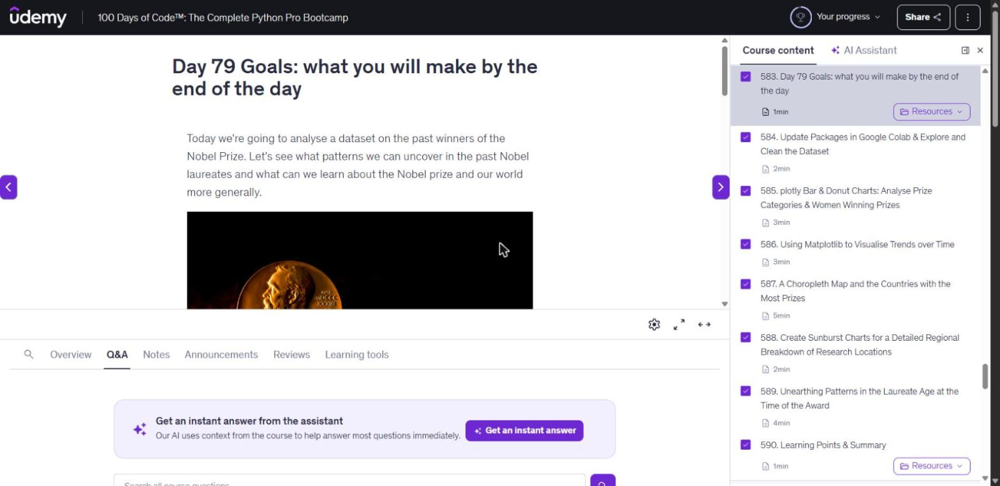
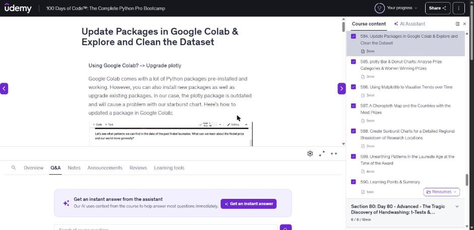
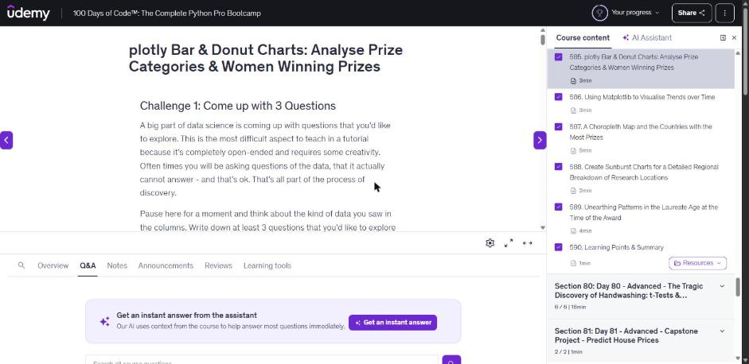
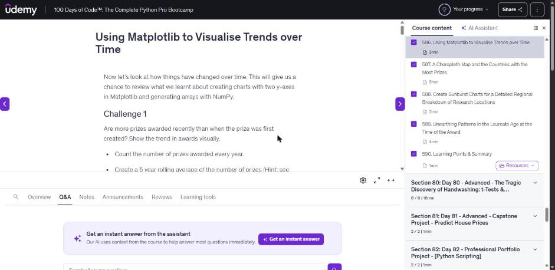
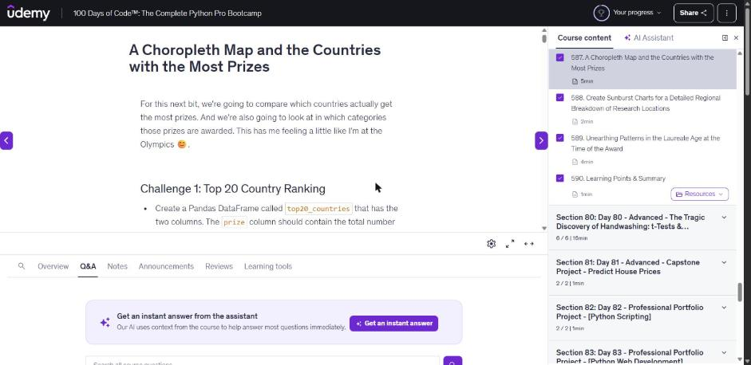
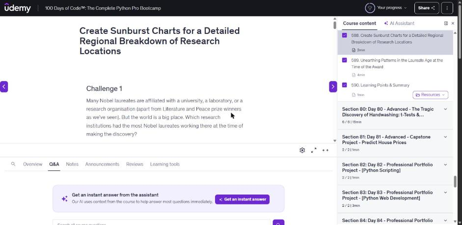
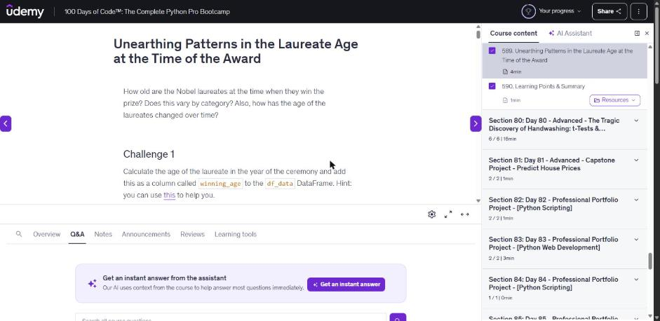
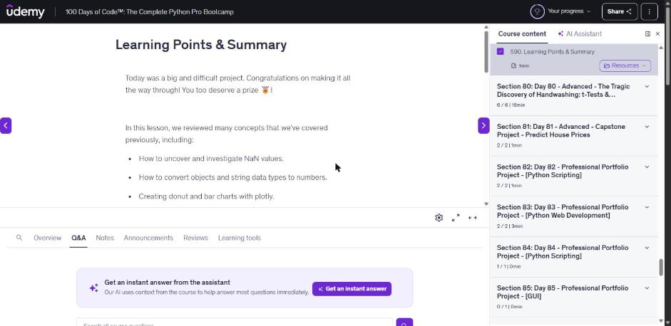

# 🚀 079 Nobel Prize Analysis

Day 79 of Udemy's *100 Days of Code: The Complete Python Pro Bootcamp*: analyse 120 years of Nobel Prize data with Pandas, Plotly, Matplotlib and Seaborn. It is for course participants who want runnable, tested code and for anyone browsing for ideas.

## 📚 Table of Contents

- [Overview](#-overview)
- [Requirements](#-requirements)
- [Setup](#-setup)
- [Run](#-run)
- [Tests](#-tests)
- [License](#-license)
- [Links](#-links)
- [Appendix: Project documents](#-appendix-project-documents)

## 🧭 Overview

The project answers the questions of the Day 79 assignment: how the data looks and what is missing, which categories award the most prizes, how many laureates are women, how the number of prizes changed over time, which countries, organisations and cities win the most, and how old laureates are when they win.

| Folder | What it holds |
| --- | --- |
| `src/nobel_analysis/` | The analysis functions, named as in the assignment, and `constants.py` |
| `tests/` | Tests that assert the values from the lecture |
| `notebooks/` | The Jupyter notebook that follows the lecture step by step |
| `data/` | `nobel_prize_data.csv` from the lecture (962 prizes, 1901 to 2020) |
| `docs/` | Project documents, screenshots (`docs/images/`) and the wiki sources (`docs/wiki/`: English, Danish, Bahasa Malaysia) |
| `scripts/` | `scan.sh` (opengrep), `make_wiki.py` (generates the wiki pages) |

### 🖼️ Lecture steps

One screenshot per lecture step (Udemy lectures 583 to 590). The [wiki][wiki] (English, Dansk, Bahasa Malaysia) explains what each step teaches.

**Step 1: The goals of the day**



**Step 2: Explore and clean the data set**



**Step 3: Bar and donut charts with plotly**



**Step 4: Trends over time with Matplotlib**



**Step 5: A choropleth map and the top countries**



**Step 6: Sunburst charts of research locations**



**Step 7: The age of the laureates**



**Step 8: Learning points and summary**



## 📋 Requirements

- Python 3.13 or newer, to run the code.
- `pandas`, `numpy`, `plotly`, `matplotlib` and `seaborn`, the runtime dependencies the charts need; they are installed by the setup below.
- `pytest`, `ruff`, `mypy` and Jupyter, only for development; installed with the `dev` extra.
- Optional: [Doxygen][doxygen] to build the API documentation from the source comments.

## 🛠️ Setup

Create and use a local virtual environment named `.venv`.

Windows (PowerShell):

```powershell
python -m venv .venv
.venv\Scripts\Activate.ps1
python -m pip install --upgrade pip
python -m pip install -e ".[dev]"
```

Linux and macOS:

```bash
python3 -m venv .venv
source .venv/bin/activate
python -m pip install --upgrade pip
python -m pip install -e ".[dev]"
```

Leave out `[dev]` if you only want to run the analysis.

## ▶️ Run

Print the answers to the lecture questions:

```bash
python -m nobel_analysis
```

Open the notebook:

```bash
jupyter lab notebooks/Nobel_Prize_Analysis.ipynb
```

Build the API documentation (Doxygen reads the comments in `src/`):

```bash
doxygen Doxyfile
```

## 🧪 Tests

```bash
python -m pytest
python -m mypy
python -m ruff check
```

Before pushing, scan the code with opengrep (default path `~/.opengrep/cli/latest/opengrep.exe`):

```bash
bash scripts/scan.sh
```

## 📄 License

GNU Affero General Public License v3.0, see [LICENSE][license].

## 🔗 Links

- [Repository][repository]
- [Documentation][documentation]
- [Issue tracker][issues]

## 📎 Appendix: Project documents

The documents a newcomer needs, in reading order.

| Document | What it tells you |
| --- | --- |
| [AGENTS.md][agents] | The rules AI agents follow in this repository |
| [Business Case][BC-001] | Why the project exists, its scope and success criteria |
| [Stakeholder Analysis][SA-001] | Who is involved; the stakeholder IDs used for owners and reviewers |
| [Project Plan][PP-001] | The gateways and their schedule |
| [Milestones][milestones] | One document per gateway: Go/No-Go criteria and tasks |
| [Artifact registry][registry] | Where each artifact type lives, the next version, the PO language and domain |
| [Wiki sources][wikisrc] | The lecture steps explained in English, Danish and Bahasa Malaysia |
| [Traceability matrix][TM-001] | How the artifacts link and when each was last reviewed |
| [Framework README][framework-readme] | The framework this project uses |
| [Framework changelog][framework-changelog] | What changed in each framework release |

---

[doxygen]: https://www.doxygen.nl/
[wiki]: https://git.tirsystem.com/Tirsvad-Udemy-100-days-of-code/079-Nobel_Prize_Analysis/wiki
[license]: ./LICENSE
[repository]: https://git.tirsystem.com/Tirsvad-Udemy-100-days-of-code/079-Nobel_Prize_Analysis
[documentation]: https://git.tirsystem.com/Tirsvad-Udemy-100-days-of-code/079-Nobel_Prize_Analysis/wiki
[issues]: https://git.tirsystem.com/Tirsvad-Udemy-100-days-of-code/079-Nobel_Prize_Analysis/issues
[agents]: ./AGENTS.md
[BC-001]: ./docs/business-case.md
[SA-001]: ./docs/stakeholder-analysis.md
[PP-001]: ./docs/project-plan.md
[milestones]: ./docs/milestones/
[registry]: ./docs/artifact-registry.md
[wikisrc]: ./docs/wiki/Home.md
[TM-001]: ./docs/sqa/traceability-matrix.md
[framework-readme]: ./framework/README.md
[framework-changelog]: ./framework/CHANGELOG.md
