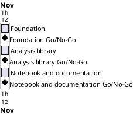

# Project Plan

## Metadata
| Key | Value |
| --- | --- |
| ID | PP-001 |
| CrossReference | [BC-001], [SA-001], [MIL-001], [MIL-002], [MIL-003] |
| Language | en |
| Domain | it |

## Version History
| Date | Status | Author | Reviewer | Change | Commit |
| --- | --- | --- | --- | --- | --- |
| 2026-11-12 | Accepted | Jens Tirsvad Nielsen | AI as stand-in for S01 | Initial version | [23ad5bb] |

---

## Purpose

This plan schedules three gateways that turn the Day 79 Nobel Prize assignment into a tested repository, a notebook and a three-language wiki, inside the Business Case constraint of completion by 2026-11-12.

## Planning Assumptions

- The plan starts and ends 2026-11-12, per the Business Case constraint ([BC-001]).
- One branch and one pull request per gateway; each pull request closes its issues.
- Stakeholders are served as [SA-001] sets out: S01 accepts the plan in chat; S02 and S03 are informed through the README and the wiki.
- Baseline: the plan was created fresh; no earlier baseline exists.

## Gateway Schedule

| Gateway | Document | Window | Decision date | Owner | Stories | Main deliverable |
| --- | --- | --- | --- | --- | --- | --- |
| Foundation | [MIL-001] | 2026-11-12 | 2026-11-12 | S01 | none (technical tasks) | Project configuration, Doxyfile, data, set-up guide, repository description |
| Analysis library | [MIL-002] | 2026-11-12 | 2026-11-12 | S01 | none (technical tasks) | Tested `nobel_analysis` package |
| Notebook and documentation | [MIL-003] | 2026-11-12 | 2026-11-12 | S01 | none (technical tasks) | Notebook, screenshots, README and wiki in en, da and ms |



## Scope Coverage

| Business Case scope item | Gateway |
| --- | --- |
| Python package under `src/`, tests under `tests/` | [MIL-002] |
| `pyproject.toml`, `.gitignore`, Doxyfile, `.venv` guide, data | [MIL-001] |
| The Day 79 lecture steps as a notebook | [MIL-003] |
| README and wiki | [MIL-003] |
| Local opengrep scan before every push | [MIL-001], [MIL-002], [MIL-003] |

## Dependencies

```
MIL-001 → MIL-002 → MIL-003
```

A No-Go on a gateway holds the later gateways; S01 decides whether the end date 2026-11-12 moves, and records the move in a new Version History row of this plan.

## Plan Risks

| Risk | Impact | Mitigation |
| --- | --- | --- |
| The dataset `nobel_prize_data.csv` is not available | Real-value tests and the notebook cannot run on real data | The run stops at MIL-001 task 4 and asks S01; tests use a synthetic fixture meanwhile |
| The git host is unreachable or a token lacks a scope | Issues, pull requests or the description cannot be published | The work stays on local branches; the run stops and reports |
| Language criteria of QC-LANG-001 cannot be closed by a stand-in | A document stays `Go-with-conditions` | S01 confirms them in chat when accepting the plan |

## Open Issues

- No domain dictionary (`DICT`) is written; the PO terms are those of the course and are used consistently.
- The repository URL named in the request (`Tirsvad-Udemy-100_days_of_code`) differs from the configured remote (`Tirsvad-Udemy-100-days-of-code/079-Nobel_Prize_Analysis`); the plan uses the configured remote.

---

[BC-001]: ./business-case.md
[SA-001]: ./stakeholder-analysis.md
[MIL-001]: ./milestones/mil-001-foundation.md
[MIL-002]: ./milestones/mil-002-analysis-library.md
[MIL-003]: ./milestones/mil-003-notebook-and-docs.md
[23ad5bb]: https://git.tirsystem.com/Tirsvad-Udemy-100-days-of-code/079-Nobel_Prize_Analysis/commit/23ad5bbc2f45375d6f19cfe3fcb6a3fbe9c9c97b
